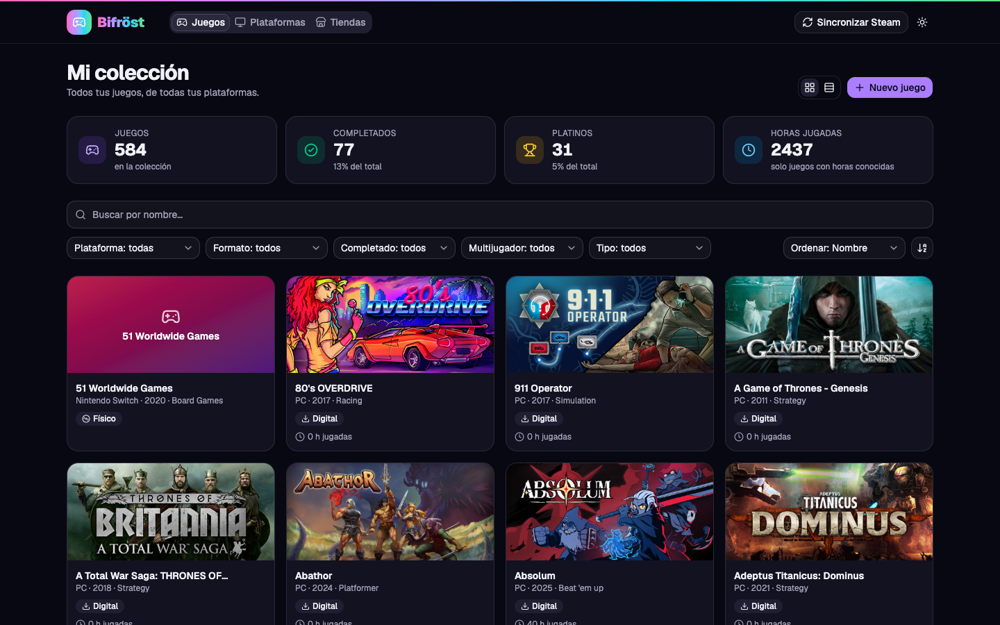
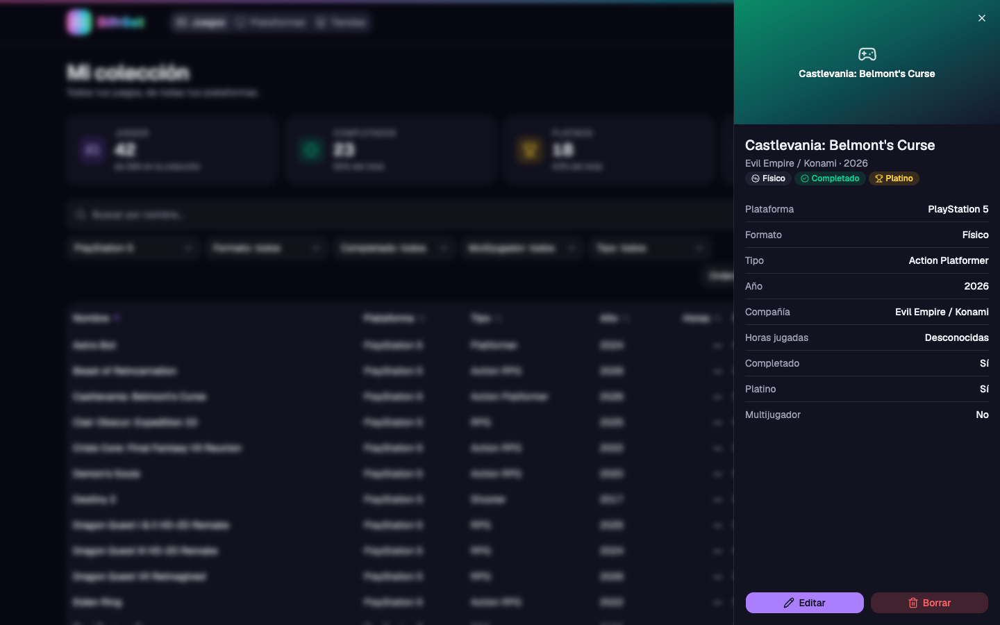
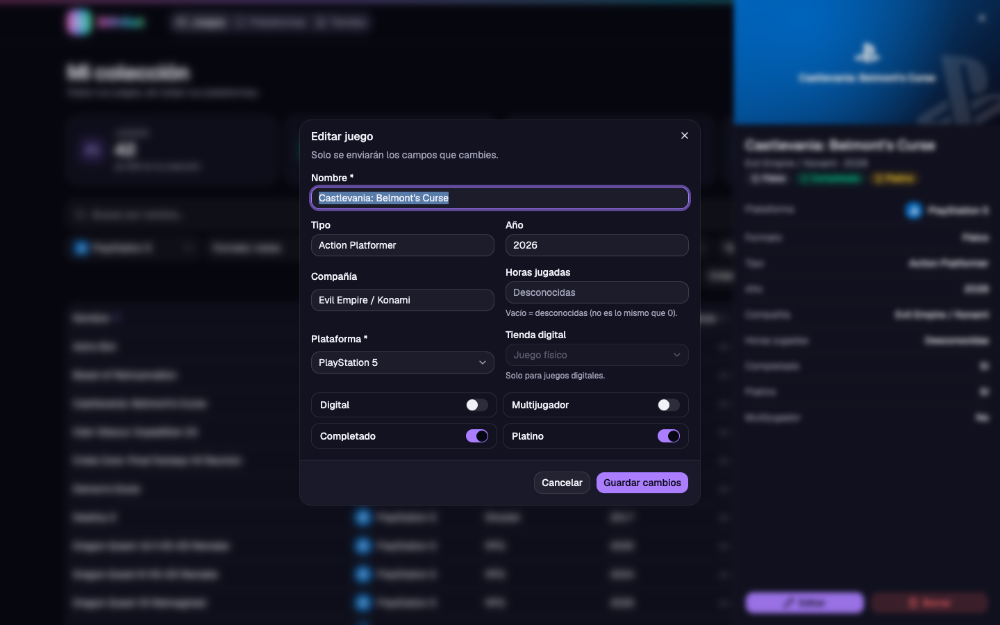
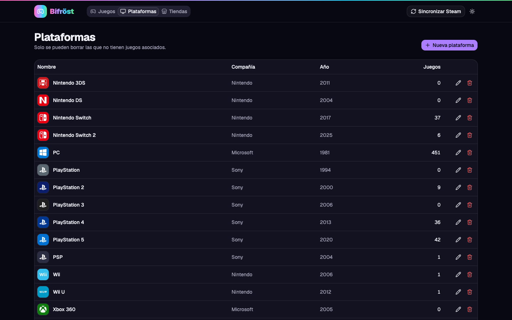
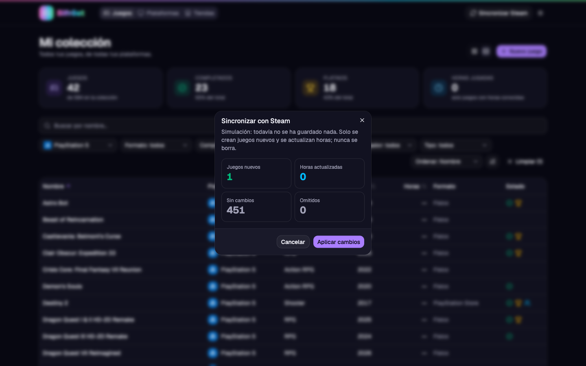
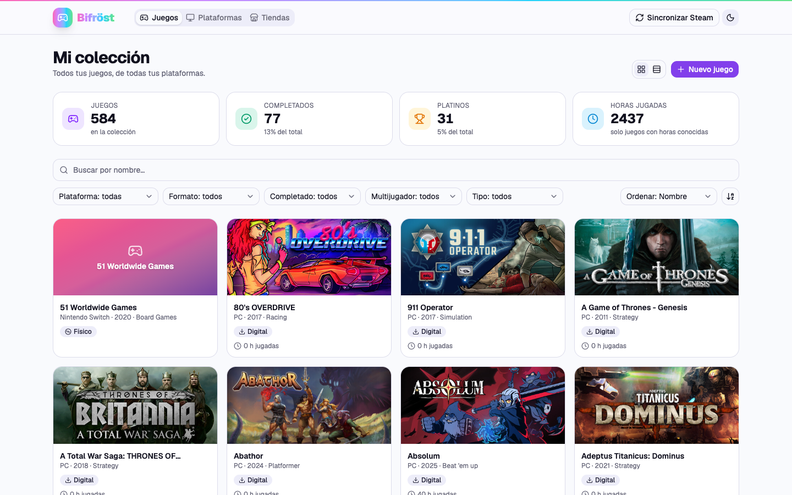
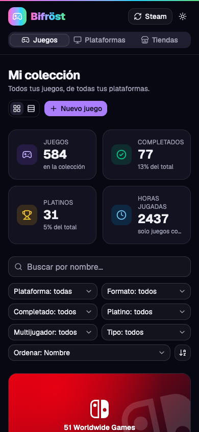

<div align="center">

# 🌈 Bifröst Web

**A modern, dark-themed web app to browse and manage your video game collection.**

The frontend for [Bifröst](https://github.com/Chemita1983/Bifrost), a personal video game collection API.

[](https://react.dev)
[](https://vite.dev)
[](https://tailwindcss.com)
[](https://ui.shadcn.com)
[](https://tanstack.com/query)
[](LICENSE)



</div>

## ✨ Features

- 🎮 **Your whole collection at a glance**: cards with covers (your own cover URL or the Steam one), or a compact sortable table.
- 🏷️ **Platform and store logos** everywhere. Games without a Steam cover get a placeholder in their platform's colours.
- 🔎 **Instant search and filters**: by name (accent-insensitive), platform, digital/physical, completed, platinum, multiplayer and type. Everything is filtered in the browser, so it is instant.
- 📊 **Live counters**: games, completed, platinum trophies and hours played, following the active filters.
- 📝 **Create, edit and delete games** with a validated form, including a cover URL with live preview. Edits only send the fields you changed.
- 🕹️ **Manage platforms and digital stores**, with a clear message when one still has games.
- 🔄 **Safe Steam sync**: a dry run shows what would change, and nothing is saved until you confirm.
- 🌙 **Dark "gamer" theme** by default, with a light mode that is remembered.
- 📱 **Responsive**: works from phone to wide screens.

## 📸 Screenshots

| Game detail | Edit form |
| --- | --- |
|  |  |

| Platforms | Steam sync (dry run) |
| --- | --- |
|  |  |

| Light mode | Mobile |
| --- | --- |
|  |  |

## 🚀 Getting started

### Requirements

- [Node.js](https://nodejs.org) 22 or newer.
- The [Bifröst](https://github.com/Chemita1983/Bifrost) API running (by default on `http://localhost:8080`).

### Run it

```bash
npm install
npm run dev
```

Open <http://localhost:5173>.

If Bifröst runs somewhere else, point the dev proxy to it:

```bash
BIFROST_API_URL=http://localhost:9090 npm run dev
```

### Run it with Docker

The [`Dockerfile`](Dockerfile) builds the app (Node) and serves the static files with nginx ([`nginx.conf`](nginx.conf)), which also forwards `/api/...` to the `bifrost-app` container. It is meant to run together with the backend: the `web` service of the [Bifröst](https://github.com/Chemita1983/Bifrost) `docker-compose.yml` builds this folder (variable `WEB_PATH`), so from the Bifröst repository:

```bash
docker compose --env-file bifrost.env up -d --build
```

Open <http://localhost:3000>. After changing the frontend code, rebuild only this service with `docker compose --env-file bifrost.env up -d --build web`.

### Scripts

| Command | What it does |
| --- | --- |
| `npm run dev` | Starts the dev server with hot reload. |
| `npm run build` | Builds the production files into `dist/`. |
| `npm run preview` | Serves the production build locally. |
| `npm run lint` | Lints the code with oxlint. |

## 🔌 How it talks to the API

The Bifröst API has no CORS configuration, so the browser cannot call it directly from another origin. Instead, the app **always calls `/api/...`** and a proxy forwards the request to Bifröst **removing the `/api` prefix**:

```text
Browser ──► /api/videogames ──► (Vite proxy) ──► http://localhost:8080/videogames
```

- In development this is the `server.proxy` in [`vite.config.js`](vite.config.js).
- In Docker, nginx does the same: `/api/` is proxied to `http://bifrost-app:8080/` through the Compose network.

The API has no pagination and no endpoint for a single game, so the app loads the whole collection once, caches it with TanStack Query and does all the filtering, sorting and detail views in the browser. After any create, edit or delete the cache is refreshed automatically.

## 🗂️ Project structure

```text
src/
├── api/client.js            # fetch wrapper: JSON, /api base URL, API errors
├── components/              # shared pieces (cover image, confirm dialog, theme toggle…)
│   └── ui/                  # shadcn/ui components (generated)
├── features/
│   ├── videogames/          # collection page, filters, grid, table, detail, form
│   ├── catalogs/            # platforms and digital stores management
│   └── steam/               # Steam sync button (dry run + confirm)
├── lib/                     # cn() helper and theme handling
├── App.jsx                  # header + tabs
└── main.jsx                 # providers: TanStack Query, toasts
```

Each feature keeps its raw HTTP calls in `api.js` and its TanStack Query hooks in `queries.js`; components never call `fetch` directly.

## 🧱 Tech stack

- [React 19](https://react.dev) + [Vite 8](https://vite.dev) (JavaScript)
- [Tailwind CSS 4](https://tailwindcss.com) + [shadcn/ui](https://ui.shadcn.com) (Radix primitives, [Lucide](https://lucide.dev) icons)
- [TanStack Query 5](https://tanstack.com/query) for data fetching and caching
- [Sonner](https://sonner.emilkowal.ski) for toasts
- Brand logos from [Simple Icons](https://simpleicons.org), [CoreUI Brand Icons](https://coreui.io/icons) (both CC0) and [Wikimedia Commons](https://commons.wikimedia.org/wiki/File:Nintendo_Switch_2_logo.svg) (public domain), embedded as SVG paths in [`src/components/brand-icons.js`](src/components/brand-icons.js)

## 🗺️ Roadmap

- [x] Docker image (multi-stage build + nginx with the `/api` proxy) and a `web` service in the Bifröst Docker Compose.
- [ ] Automated tests with Vitest + Testing Library.
- [ ] Form validation with React Hook Form + Zod if the forms grow.

## 📄 License

[MIT](LICENSE) © 2026 Chemita1983

Game cover images are loaded from the Steam CDN, and platform and store logos are trademarks of their respective owners. They are used here only to identify each platform or store.
